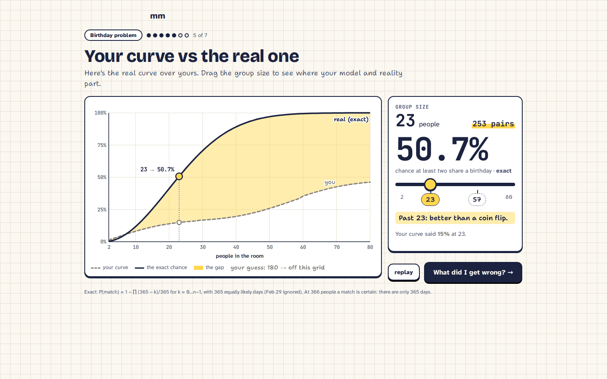
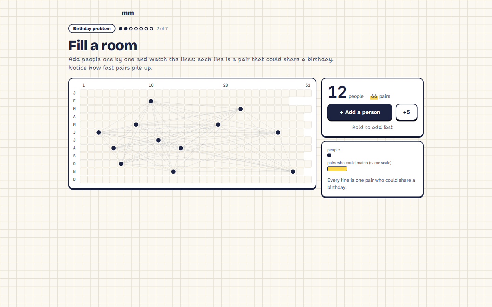
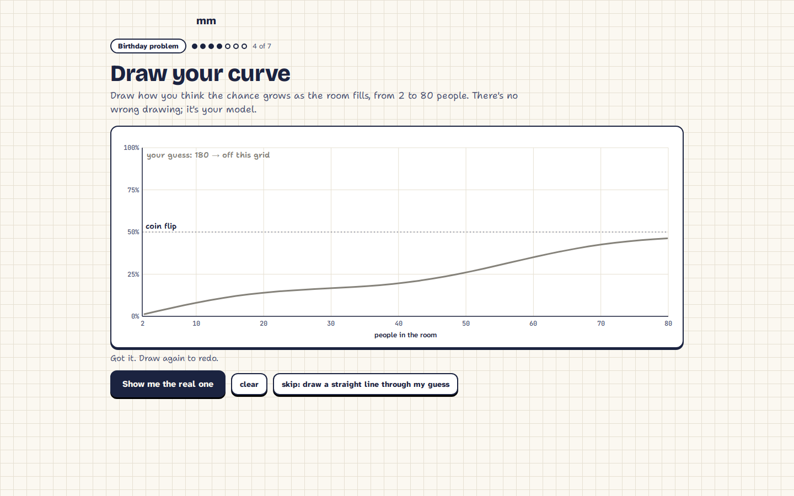
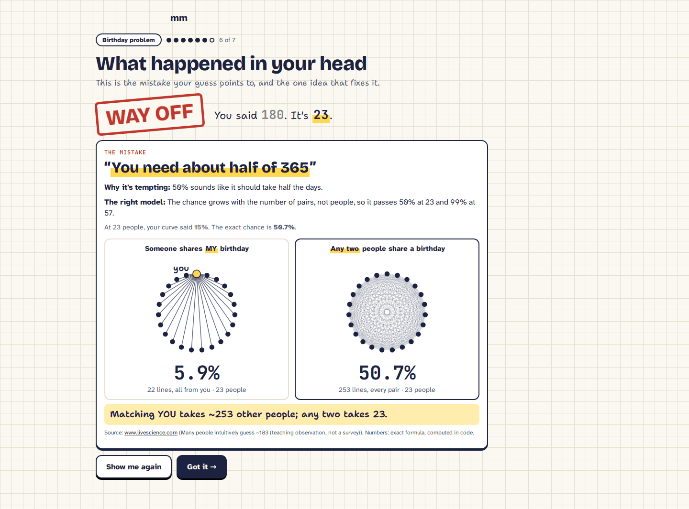
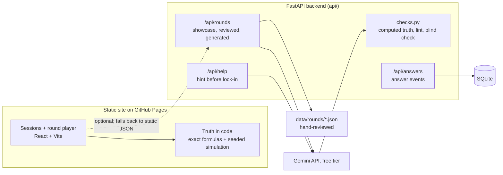

# Onionskin

**See your thinking in layers.**

Like an animator's onion skin, your guess stays on screen as a faint pencil layer while the real answer is drawn over it in ink. Short visual sessions take you from not understanding a concept to understanding it: you guess first, poke a real example, push it to the extremes, see your model next to reality, and get your exact mistake named.

**Live:** https://alexander-freedman.github.io/Swamphacks26-DSI/ (birthday session: [`?session=birthday`](https://alexander-freedman.github.io/Swamphacks26-DSI/?session=birthday))



*Birthday session, screen 5 of 7: the dashed line is the curve the learner drew, the solid line is the exact probability, the yellow is the gap. At 23 people the real chance is 50.7% (computed); this learner's curve said 15%.*

Built at SwampHacks XII (Oct 16-18 2026), Entertainment & Creative Technology track.

## What it does

Every session is 2-3 minutes and uses five moves ([docs/experience.md](docs/experience.md)):

| Move | On screen |
|---|---|
| 1. Guess first | You commit a guess in pencil before seeing anything, plus how sure you are. |
| 2. Watch a real example run | One concrete case plays out and you can poke it (add a person, empty the room, try again). |
| 3. Push it to the extremes | One big slider for the knob that matters; the ink truth moves live. |
| 4. Your model next to reality | Your pencil guess or drawn curve stays on the same axes as the ink truth, the gap shaded. |
| 5. Your mistake named | One card: what you probably thought, why it's tempting, the fix in two sentences. Then one rematch with new numbers. |

No points, XP, streaks or leaderboards: the reward is the reveal.

**Birthday problem (live, 7 screens).** Guess how many people it takes for a 50% chance of a shared birthday, fill a room one person at a time and watch the pair lines pile up (23 people = 253 pairs, computed), empty it and try again, draw your own curve, then see it under the exact curve and drag the group size from 2 to 80. The mistake card is picked from your guess ("it's about MY birthday" or "you need about half of 365"), then a rematch.

| Fill a room | Draw your curve | Mistake named |
|---|---|---|
|  |  |  |

**Coming next (in review, not on main yet):** a coin streak session (the longest run in 100 fair flips averages 6.98, computed) and a positive test session (1% base rate, 90% sensitivity, 9% false positives: a positive means about a 9.2% chance you're sick, computed). On main today both play as short question rounds in the round player on the home page.

**Typed topics (labelled extra, backend only for now).** `POST /api/rounds` turns a typed topic into a short 3-question round. Ten hand-reviewed extra topics (Monty Hall, compound interest, regression to the mean, ...) are served without a model call; anything else is generated and labelled *auto-checked*. There is no typed-topic box on the live site yet.

**Help chat (API only for now).** `POST /api/help` answers "I'm stuck" questions about the screen you're on, in plain words. The panel inside the sessions isn't merged yet.

## How it works



- **Frontend:** React 19 + TypeScript + Vite, deployed as a static site to GitHub Pages (`scripts/deploy-pages.sh`). It needs no backend: the showcase rounds ship as static JSON next to the page. Each session lives in its own folder under `web/src/sessions/` and is picked up by `registry.ts`.
- **Truth is computed in code, never trusted from a model.** The birthday curve is the exact formula 1 − ∏(365 − k)/365; streaks and test results come from seeded simulations or exact arithmetic in `web/src/truth.ts`, re-derived on the backend in `api/app/truth.py` for checks. Formulas: [shared/schema/README.md](shared/schema/README.md).
- **Rounds:** one JSON contract, `shared/schema/round.schema.json`, generated from the Pydantic models in `api/app/schema.py`. Showcase rounds (`data/rounds/`) and extra topics (`data/rounds/extra/`) are written and checked by hand and marked *reviewed*.
- **Typed topics:** one structured-output Gemini call per fresh topic (free tier: `gemini-3.5-flash-lite`, then `gemini-3.1-flash-lite`, then Gemma), cached on disk by normalized topic. The model writes a spec, not the answer: `api/app/checks.py` evaluates every answer expression, checks it lands in the right band, lints the slider bands, and drops anything that fails. Items code can't compute go to a blind check by a second model; items with no blind answer are reported as `unchecked`, never as checked. Limits: 12 generations per IP per hour, a 480/day soft cap under the free quota, and a fallback to the showcase topics on any failure. Model choice and quotas: [docs/research/gemini.md](docs/research/gemini.md).
- **Help chat:** the server builds the context (topic, screen, misconceptions, the true value) itself and ignores any "truth" the client sends. Before you lock in a guess it only hints, and the reply is scanned for the true value: a leak is swapped for the screen's static hint. Per-IP limit (10 per 10 min) and a daily cap (150), both env-configurable; capped or offline, it returns the static hint with HTTP 200, so a session never depends on it.
- **Answer events:** `POST /api/answers` maps a locked answer to its misconception and stores it in SQLite (`data/local.db`). The table is shaped to move to a Tiger Data (Timescale) hypertable; that change is in review, not on main.
- **Secrets:** the Gemini key is read from the server's environment only (kept in a git-ignored `.env`). The frontend never calls a paid API.

## Run it locally

Needs Python 3.12 + [uv](https://docs.astral.sh/uv/) and Node 22. Run the backend and frontend in two terminals.

```bash
# 1. backend on :8000 (no key needed: without GEMINI_API_KEY it runs offline and serves reviewed rounds)
cd api && uv sync && uv run uvicorn app.main:app

# 2. frontend (proxies /api to :8000; works without the backend too)
cd web && npm ci && npm run dev
# open http://localhost:5173/Swamphacks26-DSI/?session=birthday

# 3. tests
cd api && uv run pytest -q
cd web && npm test
```

Quick API check: `curl localhost:8000/api/health` and `curl localhost:8000/api/rounds`. Lint: `uv run ruff check .` in `api/`, `npm run lint` in `web/`. CI runs lint, tests and the build on every PR ([.github/workflows/ci.yml](.github/workflows/ci.yml)).

## Honest numbers

| Number | Value | Source |
|---|---|---|
| Birthday: chance of a shared birthday at 23 people | 50.7% | computed (exact formula, tested in `web/src/sessions/birthday/math.test.ts`) |
| Birthday: pairs among 23 people | 253 | computed (23 × 22 / 2) |
| Coin streak: average longest run in 100 fair flips | 6.98 | computed (exact 6.977, tested in `web/src/truth.test.ts`) |
| Positive test: chance you're sick at 1% / 90% / 9% | 9.2% | computed (`base_rate_test` in [shared/schema/README.md](shared/schema/README.md)) |
| Generation trial: topics delivered | 24 of 25 | our own 25-topic trial, prompt v2 ([NOTES.md](NOTES.md), Sat ~12:10 AM); small sample |
| Generation trial: time per topic | median 27 s, p90 51 s | same trial; too slow to generate live on stage |
| Free-tier quota on the generator model | 500 requests/day, 15/min | AI Studio rate-limit page for our project ([docs/research/gemini.md](docs/research/gemini.md)) |
| Backend tests | 72 passing | `uv run pytest -q` |
| Frontend tests | 21 | `npm test` (vitest; CI green on main) |

What the trial also showed ([NOTES.md](NOTES.md)): every generated item came out as a plain number estimate rather than a visual, several had wrong answers that slipped past the checks, and the blind check often timed out while still reporting a pass. That's why the sessions we demo are hand-built and typed topics are a labelled extra. The blind check now reports unanswered items as `unchecked`.

## Limits and what's next

- Only the birthday session is a full visual session on main; the coin streak and positive test sessions are in review.
- The backend isn't hosted yet, so the live site runs on static reviewed rounds: no typed topics or help chat in the browser until it's deployed (a Vultr/Render deploy kit is in review).
- Generated rounds are slow (median 27 s) and mostly plain estimates; a generator version that prefers curve and distribution widgets is in review.
- Progress is saved in the browser only (`localStorage`). Planned: a collection of misconceptions caught → busted, and a remix of the same topic the next day.
- On a slow single-core machine a few simulation-heavy web tests can hit vitest's default timeout; a longer timeout is in review.

## Team

- Alex Freedman ([@Alexander-Freedman](https://github.com/Alexander-Freedman)): engine, backend, data, birthday session
- Luana Maldaner ([@luanamaldaner](https://github.com/luanamaldaner)): frontend, visual design, coin streak and positive test sessions

SwampHacks XII, University of Florida, Oct 16-18 2026. Track: Entertainment & Creative Technology. How we work: [CONTRIBUTING.md](CONTRIBUTING.md). Decisions: [NOTES.md](NOTES.md). Storyboard and look: [docs/experience.md](docs/experience.md), [docs/experience-look.md](docs/experience-look.md).

## Rules and credits

- All project code was written during the event's hacking window (Fri Oct 16, 8:30 PM to Sun Oct 18, 8:30 AM).
- The five moves draw on learning-science work cited with links in [docs/experience.md](docs/experience.md) (prediction first, hypercorrection, runnable mental models, checked drawing).
- Birthday problem framing: [Live Science](https://www.livescience.com/what-is-birthday-paradox), [Conversable Economist](https://conversableeconomist.com/2014/02/22/intuition-behind-the-birthday-bets/).
- Built with React, Vite, FastAPI, Pydantic, uv and the Gemini API (free tier).

## AI tools disclosure

> **TO BE WORDED BEFORE SUBMIT.** SwampHacks XII requires disclosing AI tool use. This section is a placeholder and will be written before submission.

## License

No license file yet: all rights reserved by the authors until one is added.
