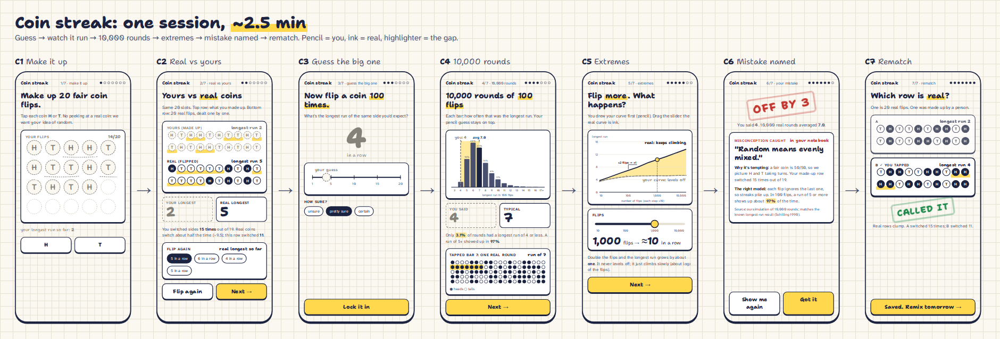
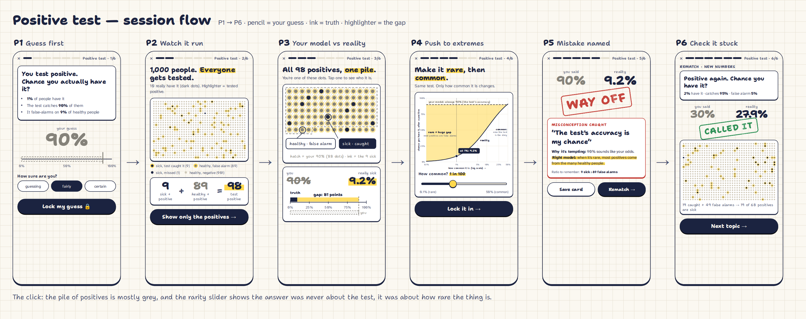
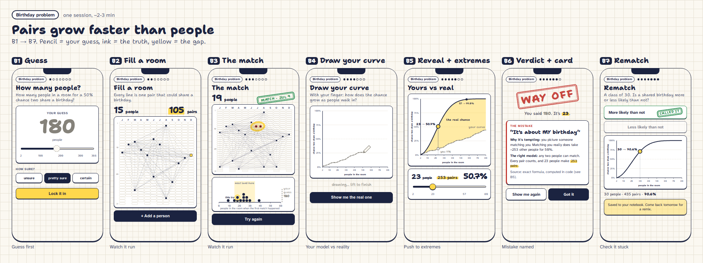
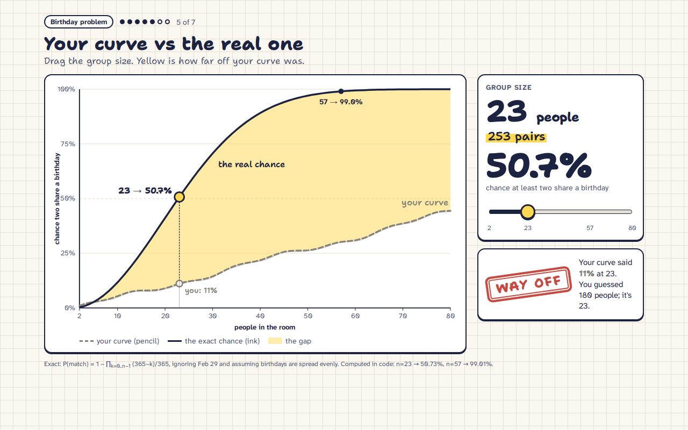

# Experience: one short visual session per concept

**Status:** design done Sat ~12:10 AM; build starts now (rule 17 plans live on each issue). Visual language: [docs/experience-look.md](experience-look.md) (@luanamaldaner, #79: "your model rides along", shared components). Interactive mockups: `docs/mockups/*.html` (#79). Static screen mockups for this storyboard: `docs/experience/*.png`.
**Goal:** someone goes from *not* understanding a concept to understanding it **through visualizations**, in a **2-3 minute session** that feels good to come back to. It's not a course. We borrow five moves from our concept-to-model research and use only the ones that make each topic click:

| Move | What it looks like on screen | Why (source) |
|---|---|---|
| **1. Guess first** | You commit a guess *before* seeing anything: drag, tap or draw it in **pencil**. | Predicting first exposes what you don't know (illusion of explanatory depth, [Rozenblit & Keil 2002](https://doi.org/10.1207/s15516709cog2605_1)); errors made with confidence are the ones corrected best ([hypercorrection, Butterfield & Metcalfe 2001](https://doi.org/10.1037/0278-7393.27.6.1491)). |
| **2. Watch a real example run** | One concrete case plays out step by step (real flips, real people, real birthdays), and you can **poke it** (re-run, tap, add one more). | A model is only useful if you can run it in your head; a concrete runnable case comes first ([Kieras & Bovair 1984](https://doi.org/10.1207/s15516709cog0803_1)). |
| **3. Push it to the extremes** | A big slider changes the one knob that matters (flips, base rate, people). The **ink** truth moves live. | Testing a rule at the extremes is where wrong models break (Clement's guess → test → fix loop; our own card-counting rep self-corrected twice this way). |
| **4. Your model next to reality** | Your **pencil** guess (a point or a curve you drew) stays on the same axes as the **ink** truth; the **highlighter** shades the gap between them. | Drawing tracks understanding, but only a *checked* drawing helps; unchecked it can lock in the wrong model (docs/research/learning-science.md). |
| **5. Your exact mistake named** | A stamped verdict + one misconception card in plain words: what you probably thought, why it's tempting, the right model in ≤2 sentences, with a source. | Feedback must engage *your* attempt, not a generic answer ([Loibl & Rummel 2014](https://doi.org/10.1016/j.learninstruc.2014.02.003) — unverified page; see learning-science.md). |

**Session shape (every topic):** Guess (10 s) → Watch it run (30-45 s) → Extremes (30-45 s) → Named mistake (15 s) → One rematch question with new numbers (20 s) → "Saved. Come back tomorrow for a remix." Total ≈ 2-3 min. No points, no XP; the only "progress" is your collection of misconceptions caught → busted (busted = you got it right twice later).

**Visual rules (Notebook Arcade):** graph paper background; **pencil** (grey, sketchy, dashed) = you; **ink** (deep blue, solid) = truth; **highlighter** (marker yellow) = the gap; verdict = rubber stamp that lands with a thud; chunky display face for numbers. Truth always animates *in* over your guess, never replaces it.

**Guidance line on every screen (decided Sat ~12:30 AM):** each screen opens with **one plain-language sentence: what to do, and why it matters**, so a first-time user is never lost. The visuals stay; the sentence sits above the main visual (body or hand font, ink-soft, ≥ 15px on phone).

| Screen | Guidance line |
|---|---|
| C1 | "Make up 20 coin flips the way you think a fair coin looks. We'll compare yours with real ones." |
| C2 | "Your row on top, real flips below. Flip again a few times: which one clumps?" |
| C3 | "Guess first: in 100 flips, what's the longest run of the same side? Your guess stays on screen." |
| C4 | "Each dot is one real round of 100 flips. See where most of them land compared with your guess." |
| C5 | "Drag to flip more or fewer coins. Watch how slowly, but surely, streaks grow." |
| C6 | "This is the mistake your guess points to, and the one idea that fixes it." |
| C7 | "One more: spot the real coin. Does the idea stick?" |
| P1 | "Guess first: you tested positive. What's the chance you actually have it? Your guess stays on screen." |
| P2 | "Here are 1,000 people; 10 are sick. Test everyone and watch who comes up positive." |
| P3 | "These are all the positives. Tap a few: how many are actually sick?" |
| P4 | "Drag how common the condition is. Watch what a positive result really means change." |
| P5 | "This is the mistake your guess points to, and the one idea that fixes it." |
| P6 | "Same test, new numbers: does the idea stick?" |
| B1 | "Guess first: how many people until it's a coin flip that two share a birthday? Your guess stays on screen." |
| B2 | "Add people one by one. Each line is a pair that could share a birthday: notice how fast pairs pile up." |
| B3 | "A match! Empty the room and try again a few times: how many people does it usually take?" |
| B4 | "Draw how you think the chance grows as the room fills. There's no wrong drawing; it's your model." |
| B5 | "Here's the real curve over yours. Drag the group size to see where your model and reality part." |
| B6 | "This is the mistake your guess points to, and the one idea that fixes it." |
| B7 | "One more, with new numbers: does the idea stick?" |

---

## Topic 1: Coin streak ("random is streakier than it feels")

| # | Screen | You see | You touch / draw | What moves | Your model vs truth | Move |
|---|---|---|---|---|---|---|
| C1 | **Fake 20 flips** | An empty row of 20 coin slots in pencil. "Make up 20 fair coin flips. Tap each coin H or T." | Tap 20 coins (or "fill for me" is *not* offered: the point is your own pattern) | Coins flip as you tap; your longest run is underlined in pencil | — | Guess first |
| C2 | **Real vs yours** | Your row, and right under it 20 **real** flips dealing in one by one in ink | "Flip again" button (poke it 3-4 times) | Real coins deal in; the longest run in each row gets an highlighter underline; a small tally "your longest: 2 · real: 5" | Two rows on the same grid: your row alternates, the real row clumps | Watch it run |
| C3 | **Guess the big one** | "100 flips. Longest run of the same side?" Big slider 1-20 + confidence (unsure / pretty sure / certain) | Drag, lock in | Pencil tick on an empty axis | — | Guess first |
| C4 | **10,000 runs** | Histogram of longest run builds from 10,000 simulated rounds of 100 flips; your pencil tick stays on top | Tap any bar → that row of 100 flips appears with its run highlighted | Bars rise in ~1.5 s; mean line ≈ 7 | Pencil tick vs ink histogram, highlighter band from your tick to the mean | Your model vs reality |
| C5 | **Extremes** | Slider: number of flips 10 → 10,000 (log scale). Ink curve: typical longest run vs flips (≈ log₂ n) | Drag the flips slider; optionally **draw** your curve first in pencil | Ink curve + dot slide; your pencil curve stays | Most people draw a flat or straight line; ink grows slowly but never stops (doubling flips adds ~1) | Push to extremes |
| C6 | **Verdict + card** | Stamp ("CLOSE" / "OFF BY 4"); card: *Random means evenly mixed* — why tempting, right model: "streaks of 5+ show up ~97% of the time in 100 flips" | "Got it" / "Show me again" | Stamp lands | — | Mistake named |
| C7 | **Rematch** | "Which row is real?" two rows of 20 (the existing which-is-real item) | Tap A or B | Ink underline on the real row's run | — | Check it stuck |

**The click:** your own made-up row sits right above a real one and visibly alternates too much.

## Topic 2: Positive test ("most positives are false alarms when it's rare")

| # | Screen | You see | You touch / draw | What moves | Your model vs truth | Move |
|---|---|---|---|---|---|---|
| P1 | **Guess** | "1% of people have it. The test catches 90% and false-alarms on 9% of healthy people. You test positive. Chance you have it?" Slider 0-100% + confidence | Drag, lock | Pencil mark on a 0-100% bar | — | Guess first |
| P2 | **1,000 people** | A 40×25 grid of 1,000 dots (icon array). 10 are sick (ink dots) | Tap "Test everyone" | Dots that test positive light up in highlighter row by row: 9 of 10 sick + ~89 healthy | — | Watch it run |
| P3 | **Zoom on positives** | Only the ~98 positive dots gather into one pile; 9 ink among 89 grey | Tap any dot → "healthy, false alarm" / "sick, caught" | Pile forms | Your % as a pencil-shaded share of the pile vs ink share 9/98 ≈ 9% | Your model vs reality |
| P4 | **Extremes** | Slider: how common it is 0.1% → 50% | Drag | Grid re-deals live; ink curve "chance you have it after a positive" vs base rate; your guess as a flat pencil line (you priced in only the test's accuracy) | Flat pencil line vs rising ink S-curve; highlighter gap biggest when it's rare | Push to extremes |
| P5 | **Verdict + card** | Stamp; card: *The test's accuracy is my chance* | — | Stamp | — | Mistake named |
| P6 | **Rematch** | Same story, new numbers (e.g. 2% common, 95% catch, 5% false alarm) | Slider | Mini icon array | — | Check it stuck |

**The click:** the pile of positives is mostly grey; dragging the rarity slider shows the answer was never about the test, it was about how rare the thing is.

## Topic 3: Birthday problem ("pairs grow faster than people")

| # | Screen | You see | You touch / draw | What moves | Your model vs truth | Move |
|---|---|---|---|---|---|---|
| B1 | **Guess** | "How many people for a 50% chance two share a birthday?" Slider 2-366 + confidence | Drag, lock | Pencil tick | — | Guess first |
| B2 | **Fill a room** | A 365-day calendar strip (12 months, no labels needed) and a "room" of people | "Add a person" (or hold to add fast) | Each person drops onto their day; thin lines connect them to every other person; a counter shows **people · pairs** (23 people → 253 pairs) | — | Watch it run |
| B3 | **The match** | When two land on the same day, the day circles in highlighter and the room shakes | "Empty the room, try again" (poke it 3-4 times) | Over several tries a small dot-plot "people when the first match happened" fills; most land near 20-30 | Your pencil tick sits on the same dot-plot | Watch it run |
| B4 | **Draw your curve** | Empty axes: people (2-80) × chance of a match (0-100%) | **Draw** your curve in pencil with a finger | — | Most people draw a slow straight line | Your model vs reality |
| B5 | **Reveal + extremes** | Ink S-curve draws in over your pencil curve; highlighter shading between; a slider for group size moves a dot along the ink curve with the pairs count | Drag group size 2 → 80 | Dot + pairs counter; at 23: 50.7%, at 57: 99% | Pencil line vs ink S-curve, gap shaded | Push to extremes |
| B6 | **Verdict + card** | Stamp; card: *It's about MY birthday* (or *You need about half of 365*, from your guess band) | — | Stamp | — | Mistake named |
| B7 | **Rematch** | "In a class of 30, is a shared birthday more or less likely than not?" | Choice | Dot on the curve | — | Check it stuck |

**The click:** the pair lines web up much faster than the people count; your straight pencil line sits far under the ink S-curve.

---

## Any typed topic (the engine)
The same five moves, with what the engine can honestly compute:
- **Guess:** slider / choice from the generated items.
- **Watch it run:** a sampler widget when one fits (dice, binomial, coins, tests, birthdays); otherwise a stepper with a worked example you click through.
- **Extremes:** the `explore` knob on a curve or distribution item.
- **Your model vs reality:** pencil marker vs ink truth on every widget; sketch-your-curve only on curve items.
- **Mistake named:** the band/option → misconception card.
Generated rounds are labelled *auto-checked*, not *reviewed*. Our own earlier prototype showed one-shot authoring of a whole new topic is not reliable without a second check (undefined notation, assumed knowledge), so generated topics stay short (3 items), plain-language, code-computed truth, and a blind second-model check where code can't compute it.

## Ask a question (help chat): final product feature, Saturday
Decided Sat ~12:30 AM; built **after the three sessions are live**, not tonight.
- **What:** a small "ask a question" panel on the side of each session. Anyone who doesn't get something can ask and keep going.
- **Knows the context:** the current topic, the current screen, and (after lock-in) your guess and the truth. It answers in plain words, in 2-3 sentences.
- **Hint before lock-in, never the answer:** before you lock a guess it gives a hint or rephrases the question; the number only comes after lock-in.
- **Never replaces the visuals:** answers point back at the screen ("drag the slider to 57 and watch the dot").
- **Limits (rule 16):** free Gemini tier only (Flash Lite), backend-only key, per-IP rate limit and a hard daily cap; when the cap is hit, the panel says so and the session keeps working.
- **Where it goes:** shown on every session; off in reduced-data/offline mode (the static site without a backend shows "help is offline").

## Coming back
- End of session: "Saved to your notebook." The collection page shows each misconception you hit as a card: *caught* (pencil) → *busted* (ink) after two later right answers.
- Tomorrow: the same topic as a **remix** (new numbers, same mistake tested) + one new topic. One light line: "3 of the last 7 days" (informational; no streak-loss pressure).

## Mockups
Static mockups in `docs/experience/` (HTML + PNG, desktop + phone); interactive ones in `docs/mockups/` (#79).

| Topic | Flow (all screens) | Key screens |
|---|---|---|
| Coin streak |  | `coin-c2-*`, `coin-c4-*`, `coin-c5-*` |
| Positive test |  | `ptest-p2-*`, `ptest-p3-*`, `ptest-p4-*` |
| Birthday |  |  |

Mockup numbers are computed (formula / simulation); sample guesses (e.g. "180 people", "90%") are invented example answers.

## What this changes in the build (to agree before I re-plan build-plan.md)
- **Keep:** predict → confidence → lock; Distribution + Curve widgets; reveal stamp; misconception card; extremes slider (#68); collection (#67).
- **Add (core):** C2 real-vs-yours rows; P2-P3 icon array with "test everyone" + pile; B2 room-filling calendar with pair lines; B4 draw-your-curve on curve items.
- **Change:** every reveal draws ink *over* the pencil guess with the highlighter gap (not a text verdict alone); each session ends with one rematch item.
- **Cut first if late:** C5 drawn curve (keep slider only), B3 dot-plot, tap-a-bar detail in C4.
